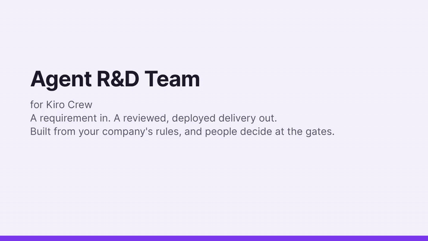

# Agent R&D Team: an agent R&D team for Kiro Crew

Agent R&D Team is a Kiro Crew app that takes a one-sentence requirement through a team of AI members the way a software
team works: roles working in parallel, your company's checks run by the app itself, people approving at the gates, and a
deployment on your own machine. It is for engineering leads who want to see how much of a delivery can run without a person,
and where a person still has to decide. You get the finished delivery in a git repository, a record of who decided what, and a
page that shows the team working.

It is built on [AI-DLC](https://github.com/awslabs/aidlc-workflows) and works from your own standards: company rules,
company checks and the team itself are plain files you replace. Every role is a Kiro Crew chat session running as a Kiro Crew
member, in its own git worktree and branch. The app dispatches the roles by their dependencies, merges their work, runs
the company checks itself, sends failures back to the role that owns them, stops at human gates, deploys locally, and draws all
of it on a live board. A finished run can be replayed and signed off.

The page has three views that share one app bar: the **CTO view** (all deliveries), **Delivery detail** (one delivery) and the
**Team board** (how the team delivered it).

## See it in 30 seconds



The same tour as a video: [assets/demo.mp4](assets/demo.mp4). It is built from this repository's preview page and its recorded runs, with captions that say what is preview data and what is measured.

You do not need Kiro Crew or any model credits to look at the app. The page is built into one HTML file with sample data:

```bash
git clone https://github.com/JiaDe-Wu/agent-rd-team && cd agent-rd-team
open docs/preview.html            # macOS; on Linux: xdg-open docs/preview.html
```

(Or save [docs/preview.html](docs/preview.html) from GitHub and open it.) It opens on the **CTO view** of a simulated company.
Two more addresses show the rest, add them after the file name:

| Address | What it shows |
| --- | --- |
| `docs/preview.html?view=board&fixture=gate` | The team board of a recorded run, stopped at a human gate; the **Replay** bar plays it |
| `docs/preview.html?view=board&fixture=finished` | The board of a finished run, with the test wall and the sign-off sheet |

Everything in the preview is sample data, so the CTO view's numbers are simulated: read [Is the CTO view real?](#is-the-cto-view-real)
before you quote one. To rebuild the file after changing the page: `cd ui && npm ci && npm run preview:build && cp preview-dist/index.html ../docs/preview.html`.

## What a delivery looks like

One real run, measured on 2026-11-23 (run `r1123cad1`, team `team-bugfix`, model `claude-haiku-5.5`, picked from the app's own model list). The
project is a small Node project with a planted bug: `orderTotal` gave no discount at exactly 10 items, and the test `tests/price.test.js` AC-2 failed.

| | Measured: this run | Estimate: not measured |
| --- | --- | --- |
| Time | 85.7 s wall time | A person alone: about 1 person-day for a small delivery; with the agent team about 0.25 person-day of their time (assumptions, [below](#is-the-cto-view-real)) |
| Cost | 0.226 Kiro Crew credits | $282 per person-day (assumption), so about $282 alone against about $71 of people's time |
| What happened | The test engineer wrote a failing regression test; the fixer changed `quantity > 10` to `quantity >= 10`; both branches merged into the run branch | |
| Checks | The app's own test step: 3 of 3 pass. Checked by hand with `node --test`: the unfixed project fails 1 of 2, the fixed one passes 3 of 3 | |
| People | No gate in this team; no write-scope violation | |

This is one run on a small fix, not an average and not evidence for a large requirement. The numbers on the left come from the run's record; the ones on the right are the CTO view's assumptions.

### A run against company rules

A second real run, on 2026-11-24 (run `r1124e063`, team `team-promo`, the example the page offers, model `auto` = the gateway's default). It is the
Black Friday example for Larkspur Outfitters: *pick 20 items and discount them with spend-and-save, a campaign page with a countdown, reference prices
and final prices, and Operations configures it in the back office and launches it in one click.*

| | Measured: this run |
| --- | --- |
| Time | 333 s (5.5 minutes) wall time, from start to deployed |
| Cost | 9.73 Kiro Crew credits for 7 role sessions (product 1.04, backend 3.05, two frontends 1.37 and 1.27, tester 1.26, compliance 1.33, deploy 0.41) |
| Rules the roles were told to look up | Frontend Engineering, Brand, Pricing and Promotion Compliance, Margin and Pricing Rules, Price-Adjustment Guarantee Rules, plus the official store's products and orders and the campaign plan |
| Company checks | 38 of 38 pass, run by the app itself. Each names the rule it comes from, for example **PRC-1** the reference price is the lowest price paid in the 7 days before the sale, not what Operations typed; **MGN-2** a plan with an item below the margin floor cannot launch; **PP-2** payouts over $20,000 need CFO approval and the sale cannot launch without it; **FE-1** no inline scripts |
| People | Two gates, *Requirements* and *Release*. Here this script approved both (the run came from `scripts/e2e_install.sh --promo` on a gateway made for the test); a real run waits for a person |
| Result | Deployed on 127.0.0.1, signed off, merged into the run repository's `main` |

What this run does not show: no check failed the first time, so nothing was sent back to a role in this run. The motion designer sat it out because the example team has no such member. It is one run of one example, on one model, and it is not an average.
You can open this run without spending anything: **Load a sample delivery** in the app's setup panel imports it, and its Replay plays it back.

### A run where a check failed and a role was sent back

A third real run, on 2026-11-24 (run `r11243b9d`, the same team and model), started from a requirement written to tempt the team into breaking the rules: *put 20 items on spend-and-save at the deepest discount that still looks good, show the crossed-out price that Operations typed in as the original price, and let Operations launch it even when the expected payouts are high.*

| | Measured: this run |
| --- | --- |
| Time and cost | 495 s wall time, 10.75 credits, 8 role sessions (the frontend developer ran twice) |
| What the checks caught | Check **AC-4** failed once: the campaign page still offered add-to-cart after the sale end time. The app sent it back to *Frontend developer #1*, who fixed it in a second round. The test count went from 34 of 35 to 35 of 35 |
| The tempting parts | The final code does not use the price Operations types (check **PRC-1**: the reference price is the lowest price paid in the 7 days before the sale), and a sale whose expected payouts pass $20,000 cannot launch without CFO approval (**PP-2**). Those are held by company checks that pass, not by the roles' goodwill |
| People | Two gates, approved by the test script on a gateway made for the test |

The failure that was caught is an ordinary missed requirement (AC-4), not one of the tempting rules. I did not check how each role reasoned about the tempting parts; the evidence is that the checks which encode those rules pass on the merged code.

## Enterprise rules, in English

The example company is **Larkspur Outfitters**, a fictitious online outdoor-gear retailer. Its rules and data are plain files, and the agents look the
originals up in a Kiro Crew knowledge source instead of writing from memory.

| What | Where |
| --- | --- |
| Rule documents, as a person at the company would write them | `knowledge/larkspur/*.md` |
| The data the rules refer to (products, orders, campaign, staff, prizes, weak passwords) | `knowledge/larkspur/data/` |
| Which rule applies to which requirement (by keyword), and who owns it | `packs/larkspur/standards.json` |
| The company checks the app runs itself on every run | `packs/larkspur-promo/tests/enterprise/` |
| The team that uses them | `team/team-promo.json` (`standards`, `standards_always`, `knowledge`, `spec_pack`, `test_command`) |
| The project the team changes | `starters/mall/` |

`knowledge/README.md` lists the documents and what each one is for. To use your own company: write your rule documents, list them in a `standards.json`
with their keywords, write the checks as `node:test` files under a pack's `tests/enterprise/`, and point a team file at them with the keys above.
A requirement that mentions a keyword gets the matching rules named in every role's task, and a failed check goes back to the role that owns the file.

## Install

From the App Store: open **Discover**, pick **Agent R&D Team** and press **Install**. (It is not in the catalog yet: the listing request is
[kirodotdev/KiroCrew#41059](https://github.com/kirodotdev/KiroCrew/issues/41059), and the catalog pull request
[kirodotdev/KiroCrewApps#105](https://github.com/kirodotdev/KiroCrewApps/pull/105) pins v0.11.0.) Until then, Kiro Crew installs it straight from this repository:

```bash
kirocrew app install https://github.com/JiaDe-Wu/agent-rd-team    # or a clone: kirocrew app install ./agent-rd-team
```

The app stays off after install. `kirocrew app enable agent-rd-team` does not turn it on: the gateway refuses until two things are answered in the
dashboard. Open the app's page (`/apps/detail/agent-rd-team`) and enable it there:

1. **Trust.** The app has executable parts (a Python backend, and its tasks run shell commands in git worktrees), so Kiro Crew asks before it runs.
   Kiro Crew 0.14 and later show a dialog that names the repository and ties your answer to it: you trust this repository, not the name. (A Kiro Crew
   with `agent.apps_allow_third_party` off refuses an untrusted app with `app_execution_denied`.)
2. **Chat control.** The sessions the app opens run file edits and shell commands without asking each time, so the owner has to allow it
   (`sessionApproval`, see below).

Then open the app from the sidebar. The first time, the page shows **Set up the example team**. One press does what Kiro Crew only lets its owner do:

- creates the `larkspur` workspace and the 14 team members (the page runs this as you, the owner; the app's own backend is not allowed to);
- writes the member templates, copies `knowledge/larkspur` to `~/workplace/knowledge/larkspur/` and attaches it as the knowledge source
  **Larkspur Outfitters**, so the roles can look up the company rules and data (Kiro Crew reads the documents with Kiro, so Kiro has to be signed in, which the roles need anyway; until it has read them the panel says so);
- fills in a first requirement. Press **Start**.

Anything already there is kept, and the panel lists each step as done or missing. **Load a sample delivery** puts a finished run into the app, so
Replay and the CTO view have something to show before you spend any model credits. If you would rather do the setup in a terminal,
`python3 scripts/setup_plan.py` prints the steps and the commands.

### Requirements

- Kiro Crew 0.13.0 or newer (the first release with the sandboxed spawn for app backends), on macOS or Linux. Windows is not supported.
- `git`, and Node 22 or newer: the company checks run with `node --test`.
- The Kiro Crew members the team files name (for example `aidlc-product-agent`) on the Agents page. A role whose
  member is missing waits, unless the team file marks it `optional`. The setup (above) adds the 14 members; run by hand,
  `python3 scripts/install_members.py` (older) or `python3 scripts/setup_plan.py` writes the member templates from `agents/` (as `<member>-template`) into
  `~/.kiro/agents` and adds them to a running Kiro Crew, using its `kirocrew` command. It never overwrites a template or
  member that already exists, and `--dry-run` shows what it would do.

### What the app is allowed to do, and why

Kiro Crew runs this app's Python only after you trust it. Its manifest asks for:

| Permission | Used for |
| --- | --- |
| `/api/apps/agent-rd-team` | The app's own routes (runs, gates, board, CTO view) |
| `/api/chat` | Opening one Kiro Crew chat session per role, and reading its state |
| `/api/models` | The model picker in the start form |
| `/api/agents` | Checking which team members exist on the Agents page |
| `/api/knowledge` | Finding the knowledge source the team file names |
| `storage` | Keeping each run's record |
| `sessionApproval` | Auto-approving the tool calls of the sessions this app opens, so that the team can work unattended |

`sessionApproval` is the one to think about: the sessions the app opens run file edits and shell commands without
asking you each time. Other Kiro Crew sessions are not changed. Each role works in its own git worktree under
`~/workplace/agent-rd-team/`. Its task lists the paths it may write and tells it not to push; the app records a change
outside those paths as a violation, but it does not sandbox the session.

Three kinds of commands run in the app's own process, and a role session can write what they run: the company checks
(`node --test` on the test files), the site of a run (`server.js`), and every `git` call on a run repository (git reads
its `.git/config`). The app starts all three under Kiro Crew's sandbox, at the `standard` tier, through the app-backend
SDK (`run_sandboxed_async` and `sandboxed_argv_async`), not with your full rights. Where the host cannot sandbox a
command, that step stops and says so; the app does not run it another way. A `git` call costs about 0.16 s more that
way (measured on Ubuntu 22.04: 160 ms against 2 ms for `git rev-parse`). `backend/team/sandbox.py` is the one place
that starts them, and a test fails if another place in `backend/` starts a command.

### Lessons

The last role, **Lessons**, lists what the delivery taught and asks you which of it to keep: a multiple-choice
question at its gate. Only what you tick is written, word for word, to `~/workplace/agent-rd-team/lessons.json`. Runs
that start later read that file once and name its cards in every role's task. Delete or edit the file at any time.

### Language

The app's screens, messages, the agents' prompts, and the example company's rules and data are English. A team file can ask for another language in its
`brief` texts. Older runs that stored their delivery tag in Chinese are still read: the words are turned into the English ones.

### Where it comes from

This app began as the agent-team sample in
[aws-samples/sample-ai-for-software-engineering-on-aws](https://github.com/aws-samples/sample-ai-for-software-engineering-on-aws)
and is maintained here. It follows [AI-DLC Workflows](https://github.com/awslabs/aidlc-workflows). Licensed under
Apache-2.0.

## Is the CTO view real?

Not as shipped. The company is fictitious and its history is generated, so the CTO view has something to show the first time it opens. Read it as
a mock-up of what the page would say about your team, not as a result.

- **Simulated:** the 445 deliveries before AI-DLC and the 1,359 after it, their cycle times, their post-release defects and the weekly chart. They are generated
  by `scripts/cto_history.py` with a fixed random seed. Every run of the script writes the same file.
- **Measured:** a delivery marked **Measured** is a real run of this app that a person signed off. Its run time, credits, checks and decisions are real.
  The page puts it next to an estimate of the same work done by people alone, and says which is which.
- **Assumptions behind the money and effort figures** (also on the page, under *Assumptions*): 60 people (5 business lines × 12); the work of a
  small / medium / large delivery is 1 / 5 / 30 person-days for people alone and 0.25 / 1 / 7 person-days of their time with the agent team;
  one person-day costs $282; the agent seat costs $40 per person per month for 3 months. Change them in `cto/history.json`.
- **The number you can quote** is one that is marked Measured, with its basis. The page's headline gives no conclusion for that reason.

The data format, what each field means and how to replace the simulated history with yours is in [docs/cto-view-data.md](docs/cto-view-data.md).

## How a run goes

| Step | What happens | Code |
| --- | --- | --- |
| 1 Requirement | The team is chosen by the words in the requirement: every team file with a `scope` and without `"routable": false` matches when one of its `keywords` occurs; the lowest `priority` wins; with no match the `fallback` team runs. The start form may pick the run's model from the models Kiro Crew offers (`GET /models`); every role then uses it, a role with its own `model` included. One run at a time | `routing.route`, `service.create_run`, `service.models` |
| 2 Team | The team file is validated (dependency order, keys, gates, paths inside the app). The task template, the company standards that match, the roster and the knowledge source are read. An optional role whose member is missing sits the run out | `team.check_team`, `standards.py`, `team.leave_out_unhired` |
| 3 Repository | `~/workplace/agent-rd-team/runs/<run>/repo` starts from the team's `starter`, its `source` or `demo/target-template`; the requirement goes into the README; the `spec_pack` is overlaid, including its `tests/enterprise/` checks | `team._setup`, `gitwork.create_repo` |
| 4 Tick | Every 2 seconds the sessions are polled and each live run advances one step | `service.pulse`, `team.TeamRun.tick` |
| 5 Start | A role starts when everything it depends on is merged and, where there is a human gate, approved. A deploy role waits for all checks to pass; a read-only reviewer waits for every writing role upstream. A writing role gets a worktree `wt/<role>` on branch `team/<run>/<role>` | `team._ready`, `team._start` |
| 6 Task | The task template filled in with the role, its branch, the paths it may write, upstream outputs, matching standards, the role's `brief`, the approved work split, and the person's notes and decisions at the gates. A fix round continues the role's own session | `team._work_task`, `team._launch` |
| 7 Merge | Uncommitted changes inside the write scope are committed for the role; changes outside it are recorded as violations; the branch is merged into the run branch, and a conflict goes back to the role. A human gate then stops the run | `team._integrate`, `gitwork.merge` |
| 8 Checks | The app runs `node --test` file by file on the run branch and assigns failures to roles by `test_owners` | `checks.run_tests`, `team._test_and_bounce` |
| 9 Review | The read-only reviewer answers `DONE: ready to deliver` or `DONE: changes needed: …` with the roles to send back to | `team._review_done` |
| 10 Gates | Approve: later roles start with the note and the per-question decisions, which are also written to `docs/aidlc/decisions.md` on the run branch. Discuss: the role answers in its own session and may revise its documents while the gate stays open. Send back: the role reworks with the note; the person may note the risk the send-back keeps from going live (`{what, amount}` in yuan, on the run's `risks`) | `team.TeamRun.gate` |
| 11 Deploy | The deploy role writes `deploy/local.json` (port, health path); the app starts the site with `HOST=127.0.0.1`, waits for the health check, and stops a site that listens beyond loopback (checked with `lsof`) | `service._deploy`, `site.Site` |
| 12 End | `done` when every role merged, `failed` when a role failed. Only a delivered run can be signed off; signing merges the run branch into the run repository's `main` | `team._settle`, `service.signoff` |

## Code map

| Path | What it is |
| --- | --- |
| `app.json` | Kiro Crew app manifest |
| `backend/` | The orchestrator: `team/team.py` (one run's state machine and the tasks), `team/service.py` (all runs, the tick, gates, sign-off, deploy), `team/routing.py`, `team/standards.py`, `team/checks.py`, `team/gitwork.py`, `team/sandbox.py` (the one place that starts a command), `team/sessions.py`, `team/board.py`, `team/cto.py`, `team/delivery.py` |
| `ui/src/` | The page: `main.tsx`, `AppBar.tsx`, `board/` (team board), `cto/` (CTO view and delivery detail) |
| `ui/preview/` | The preview page on sample data, without Kiro Crew; built into `docs/preview.html` |
| `team/` | Team files `team*.json`, the roster, task templates |
| `starters/` | Project templates of the example: `mall` (store promotion), `web` (internal web pages) |
| `knowledge/larkspur/` | The example company's rule documents and data, in English |
| `packs/` | Company checks in `tests/enterprise/`, reference implementations in `_reference/` for the checks' own tests, and the standards index `larkspur/standards.json` |
| `cto/history.json` | Simulated history for the CTO view, made by `scripts/cto_history.py`; `cto/offline.html` is the offline page |
| `docs/` | `cto-view-data.md` (the CTO view's data), `preview.html` (the preview) |
| `demo/target-template/` | The project the built-in team (`team/team.json`) starts from |
| `scripts/` | `install_members.py`, `dev-install.sh` (installs or updates the app in the local Kiro Crew), `cto_history.py` |
| `tests/` | Backend tests with a fake session manager and real git and node |

## Team file keys

Team level:

| Key | Meaning |
| --- | --- |
| `roles` | The roles; a role comes after the roles it depends on |
| `scope`, `keywords`, `priority`, `fallback`, `routable` | Choosing the team by the words in the requirement |
| `starter` / `source` / `needs_source` | Start from a project template / change an existing project / a project folder must be given |
| `spec_pack` | Pack(s) overlaid on the run repository, with the company checks |
| `standards`, `standards_always` | The company standards index; the standards that always apply |
| `knowledge` `{source, data_dir}` | The Kiro Crew knowledge source name; where the data files are |
| `roster`, `workspace` | The company's team shown on the board; the Kiro Crew workspace of the members |
| `task_template` | Task template in `team/` |
| `test_command`, `test_timeout_s`, `test_owners` | Command shown on the test wall; timeout per test file; who owns failures (globs) |
| `delivery_defaults` | Default delivery labels (kind, size, business line) |
| `defaults` | `model`, `max_fix_rounds` (2), `max_review_rounds` (0), `gate_discuss` (off), `max_discuss_rounds` (5) |

Role level:

| Key | Meaning |
| --- | --- |
| `key`, `title`, `icon`, `phase`, `stage` | Name and place on the board (`phase` is the AI-DLC phase) |
| `member`, `aidlc_agent` | The Kiro Crew member the session runs as; the AI-DLC expert it stands for |
| `depends_on`, `writable`, `outputs` | Whom it waits for; paths it may write (`!` excludes); outputs handed downstream |
| `brief`, `mission`, `assignment` | The task; what the board shows it is doing |
| `gate: "human"`, `gate_label`, `plan` | A human gate after this role; its button label; the work split file |
| `gate_preset`, `gate_revise_preset`, `gate_revise_risk` | Notes the gate dialog can fill in for approving and for sending back, and the risk filled in with the send-back |
| `questions` | File on the run branch with the questions the person decides at the gate: `{"questions": [{id, q, options: [{key, text}], recommend, why}]}`; `"multi": true` makes it a tick-any question (up to 10 options, no recommendation) |
| `remember` | `true` on the last gated role: what the person ticked is written to the lessons file when its gate is approved |
| `name_zh` | An alternative title for the role, so a send-back line in a reviewer's report can still name it (older teams wrote a Chinese title here) |
| `delivery` | File on the run branch with the proposed delivery labels |
| `optional` | Sits the run out when its member does not exist or the approved work split leaves it out |
| `deploy` `{mode: local, port, health}` | Deploy on this machine |
| `model` | The role's own model (a model picked in the start form replaces it for that run) |

## Roadmap

The aim is a team that needs fewer human decisions each time it is used, because what people decided at the
gates is kept as knowledge the next run reads. What exists today is narrower:

- Kept today: the lessons a person ticks at the last gate (`lessons.json`, read by every later run), and each
  run's gate decisions in `docs/aidlc/decisions.md`. The latter stays on that run's branch and is not read by
  other runs.
- Not done: feeding gate decisions back into the knowledge source automatically, counting how many gates a
  later run needed compared with an earlier one, and letting a gate pass without a person when a similar
  decision has been approved before. Today every gate in the team file still waits for a person.

## Test

```bash
python3 -m pytest -q                 # backend tests: Python 3.10+ and pytest; Kiro Crew's sandbox SDK is a stand-in
# the same tests in the host's real sandbox (Kiro Crew 0.13.0+ source on PYTHONPATH):
AGENT_RD_TEAM_REAL_SANDBOX=1 PYTHONPATH=/path/to/KiroCrew/src python3 -m pytest -q
(cd ui && npm ci && npm run check)   # UI: type check, component tests, build
```

Two timing-based UI tests can time out on a heavily loaded machine when test files run in parallel;
`npx vitest run --no-file-parallelism` runs them one file at a time.
